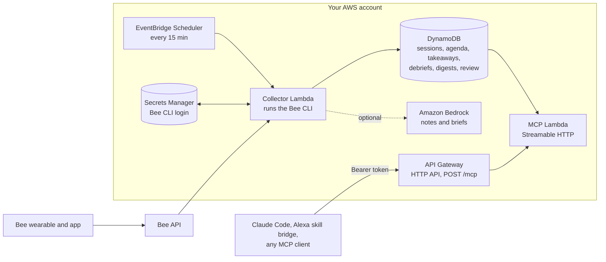

# Between Sessions

A companion for recurring 1:1 sessions (therapy, coaching, mentoring, interview loops) built on data from a [Bee](https://docs.bee.computer/docs) wearable.

Before a session it answers "what did we cover last time, what did I notice afterwards, and what do I want to bring up?" Between sessions it says what has happened since: how many days and conversations, which topics from last time came up again, Bee's insights and new todos. After a session it saves what Bee captured before the summaries get rewritten, and keeps your takeaways and debrief. The Bee's own button is an input: hold it and talk to the product by name, Marty ("Marty, start session", "Marty, end session", "Marty, debrief: ...", "Marty, agenda: ..." or "Marty, takeaway: ..."), and the next brief confirms what was filed.

> Status: built for the Build, Ship, Shape: Amazon Developer Hackathon (Bee track). The collector, the session store and the remote MCP server run on AWS; the Bedrock notes are built and ship switched off.

## Architecture



- **Collector Lambda** (`src/aws/collector.ts`, one run in `src/collector.ts`): Node 22 on arm64. It ships the Bee CLI's Linux binary from `@beeai/cli`, restores a file-store CLI login from Secrets Manager into `/tmp`, runs `bee conversations list`, `bee insights list`, `bee journals list` and `bee todos list` (all `--json`), and saves the login back if the CLI refreshed its token. Each run reads new Bee button notes, places sessions, files notes, updates the review queue and precomputes one digest per series.
- **DynamoDB** (`between-sessions`): one table. Per series, `PK = SERIES#<id>` with `SK = CONFIG | SESSION#<start>#V#<collectedAt> | AGENDA#... | TAKEAWAY#... | DEBRIEF#... | BRIEF#... | DIGEST`. Shared partitions: `CLAIMS` (which session holds each Bee conversation id), `MARKERS` (Bee button start and end times), `JOURNALS` (what each voice note did, no text), `TALLIES` (running day counts) and `REVIEW` (guesses waiting for you). The table is retained if the stack is deleted, with deletion protection on.
- **MCP Lambda** (`src/aws/mcp-handler.ts`): a stateless Streamable HTTP server with JSON responses. Tools answer from DynamoDB only, with no Bee or Bedrock calls on the request path.
- **Bedrock** (`src/notes/bedrock.ts`): when enabled, one Converse call per new session version writes a short session note and a prep brief.
- Everything is one CDK stack, `BetweenSessions` (`infra/stack.ts`), in `us-east-1`.

## How it uses Bee data

- **Read**: the last 21 days of conversations, insights, voice notes (journals) and todos, through the Bee CLI (`@beeai/cli`), every 15 minutes.
- **Finding sessions**, strongest evidence first, each Bee conversation in at most one session:
  1. **You**: a session you confirmed or retagged.
  2. **Bee button markers**: "Start session" and "End session" voice notes give the exact span; the session is built from the conversations that overlap it. A start with no end closes at the end of the run of back-to-back conversations after it (at most `maxSessionMinutes`); an end with no start opens at the start of the run before it.
  3. **The schedule window** (optional per series): conversations that overlap the weekly slot by at least `minOverlapMinutes`, adding up to `minDurationMinutes`.
  4. **A series keyword**: a conversation of 30 minutes or more whose Bee summary mentions one of the series' `captureKeywords`.
- **Tags and review**: every session carries a tag (source, confidence, status, a short reason). A named marker, or the slot plus a series keyword in Bee's summary, is filed. A slot alone (for a series with keywords) or a keyword alone is queued for review and not filed; an unnamed marker is filed under its best guess and queued. A queued guess stores only its time, length, Bee ids and reason, never a summary, and must be reviewed within Bee's 14-day history. A rejected conversation's id is remembered so it's never suggested again.
- **Insights**: Bee writes insights in nightly batches that repeat themes from earlier nights, so only the first batch after the session (within `insightWindowHours`) is attached.
- **Digest**: the collector keeps running day tallies (conversation ids and times, todo ids and times, and which conversations mention each topic word) so a gap of more than 14 days still counts. Topics are words that recur in the last session's summaries plus `captureKeywords`. The digest is off for the catch-all Other series.
- **Stored**: sessions (each part's summary and short summary, times and ids) and their first insight batch, your agenda items, takeaways, debriefs and prep briefs, marker times, the day tallies and the review queue. Bee rewrites summaries over time, so a new version is stored whenever the content changes, and the wording from right after the session is kept. From voice notes, only the words after a recognized command ("Agenda: the work trip" stores "the work trip"); any other note is kept as its id only. Sessions you mark with the Bee button (an interview, a one-off) are kept like recurring ones, but only for conversations you marked.
- **Not stored**: other conversations' summaries, raw utterances, transcripts, audio, locations or calendar data. Lambda logs hold counts, durations and ids only.
- **Tokens**: the Bee login and the MCP token live only in Secrets Manager (or a git-ignored `.env` locally).

## MCP tools

| Tool | What it does |
|---|---|
| `get_prep_brief {series?}` | What the Bee button filed lately, the review line, the since-last-session paragraph, the last session (short summary, insight titles, your takeaways and debrief), the open agenda, and when the next session is ("not scheduled" without a schedule). Uses the Bedrock note when there is one |
| `get_since_last_session {series?}` | Days and conversations since the last session, topics from it that came up again, Bee's insight titles since, and todos added. Counts and topic words only |
| `get_last_session {series?}` | The latest session: date, duration, how it was found, parts, Bee's summary, your debrief, the insights after it, version count and when it was collected |
| `list_sessions {series?, limit?}` | Recent sessions, newest first: ids, dates, durations, how each was found, part and version counts, no summaries |
| `add_agenda_item {series?, text}` | Something to bring up next time; it stays open until the next session starts |
| `list_agenda {series?}` | Open agenda items, oldest first, each marked as from you or from the Bee button |
| `remove_agenda_item {series?, text}` | Takes an open item off the agenda, matched by its words |
| `save_takeaway {series?, text}` | Your own takeaway, filed under the latest session |
| `review_sessions {}` | Guesses waiting for you: date, time, length, the guessed series, why, and when Bee's history drops it. No summaries |
| `retag_session {id, series?, notASession?}` | Confirms or corrects a guess or a filed session, or drops it; reads back what changed, including agenda effects |
| `help {}` | The menu, short enough to read aloud, and what's out of scope |

When a request names no series, the tools use the only series, or the most recently ended session's series (looking back, takeaways) or the next scheduled one's (prep, agenda), say which, and ask when it's unclear. Series names are fuzzy-matched ("Akme" finds "Acme interview").

The server also sends instructions (the menu and answer rules) on connect, adds one suggested next step to every answer, and offers prompts for `/` in Claude Code: `prep`, `since`, `agenda`, `takeaway`, `review` and `help`. All of these come from one capability list, `src/mcp/capabilities.ts`.

Descriptions are written to be read aloud, for voice use through an Alexa skill bridge such as [alexa-skill-mcp-bridge](https://github.com/KayLerch/alexa-skill-mcp-bridge).

## The Bee button

In the Bee app, set the Action Button's "Hold and speak" to **Voice Notes** (not Voice Assistant): each hold-and-speak becomes a Bee journal, which the CLI can read. Optionally set double press to "Process current conversation", so pressing it at the end of a session makes Bee finish that conversation sooner. Then hold the button and say the product's name, **Marty** (or **Martin**), then the command. A voice note without the name is a plain note, whatever it says.

| You say | What happens |
|---|---|
| "Marty, start session" or "Marty, start coaching" | Marks a session's start at the time of the note |
| "Marty, start session: Acme interview" | Marks the start of a session in that series, creating it (with no schedule) if it's new |
| "Marty, end session" | Marks the end; the session is built from the conversations in between |
| "Marty, debrief: ..." | Saves your debrief on the session that just ended |
| "Marty, agenda: ..." or "Marty, for therapy: ..." | Adds an agenda item for the next session, marked "from Bee" |
| "Marty, takeaway: ..." | Saves a takeaway on the session that just ended |
| "Marty, drop ... from my agenda" | Removes an open agenda item |
| "Marty, that was Acme", "Marty, retag: coaching", "Marty, not a session" | Corrects the session that just happened |

Command words are matched forgivingly ("and session" counts as "end session", and colons can be left out). The name is read from Bee's raw transcript, because Bee's cleaned-up text drops it. The button gives no feedback; Bee has a voice note ready in about 5 seconds and the collector files it within 15 minutes, so the next brief or digest opens with what was filed, for example "Got it: session ended Thu 4:32 PM, debrief saved, 1 agenda item added", and reports any note addressed to Marty that couldn't be filed or understood. An unnamed start with several series goes to the series whose slot it falls in, or to the catch-all Other series, and waits for review.

## Series config

`series.example.json` is synthetic. Each series has an `id`, a `name` and a `timezone`, and optionally:

- `weekday` (0 is Sunday), `windowStart` and `windowEnd` (local `HH:MM`): the weekly slot. All three or none; a series with no weekly slot and no dated sessions gets its sessions from markers (and keywords) only.
- `dated`: one-day slots, for example `[{ "date": "2026-11-05", "start": "18:00", "end": "18:10" }]`, local to the series' timezone. On a date with any dated entry the weekly slot doesn't apply; several entries on one day are separate slots, and `{ "date": "2026-11-10", "skip": true }` means no slot that day. A series with no weekly slot can have dated sessions (a one-off interview).
- `spokenNames`: other names you might say, for example `["coaching"]` for "Weekly coaching".
- `captureKeywords`: words in Bee's summaries that point at the series. With them, a slot alone no longer files a session (the coaching slot in an off week waits for review instead).
- `minOverlapMinutes` (10), `minDurationMinutes` (30), `maxSessionMinutes` (120) and `insightWindowHours` (72).

## Deploy to AWS

Requires Node 22.18+, Yarn via Corepack, the AWS CLI, and an AWS account bootstrapped for CDK (`corepack yarn cdk bootstrap`).

```bash
corepack yarn install

# 1. A dedicated Bee CLI login for the Lambda, stored in Secrets Manager.
#    Approve the login in the Bee app; the token is never printed.
scripts/setup-bee-secret.sh

# 2. Deploy the stack (Bedrock notes off).
corepack yarn cdk deploy BetweenSessions

# 3. Tell the collector which sessions to look for.
cp series.example.json series.local.json      # edit: your weekday, times and timezone
corepack yarn seed --store dynamo --file series.local.json

# 4. Run the collector once instead of waiting for the schedule.
aws lambda invoke --function-name between-sessions-collector out.json && cat out.json
```

The response holds counts only, for example `{"conversations":80,"insights":90,"series":1,"matched":3,"written":3,...}`.

Seeding is optional: a "Marty, start session: <name>" voice note creates an unscheduled series by itself.

### Connect Claude Code

The stack prints `McpUrl` and creates the bearer token as the secret `between-sessions/mcp-token`. With your own AWS credentials:

```bash
URL=$(aws cloudformation describe-stacks --stack-name BetweenSessions \
  --query "Stacks[0].Outputs[?OutputKey=='McpUrl'].OutputValue" --output text)
TOKEN=$(aws secretsmanager get-secret-value --secret-id between-sessions/mcp-token \
  --query SecretString --output text)
claude mcp add --transport http between-sessions "$URL" --header "Authorization: Bearer $TOKEN"
unset TOKEN
```

To smoke-test it without the token showing up, `corepack yarn check:remote` reads the URL from the stack and the token from `MCP_TOKEN`, and prints only shapes and counts.

### Turn on Bedrock notes

```bash
corepack yarn cdk deploy BetweenSessions -c notes=true                       # Claude Sonnet 5.5
corepack yarn cdk deploy BetweenSessions -c notes=true -c bedrockModelId=us.amazon.nova-lite-v1:0
```

Try the prompt on synthetic data first with `corepack yarn try-notes [--model <id>]`.

### Cost

For one person, a few dollars a month at most:

- Collector: about 2,900 runs a month at roughly 7 s and 1 GB each (about 20,000 GB-seconds), which fits in the Lambda free tier and costs about $0.30 a month without it.
- Secrets Manager: $0.40 a month per secret, two secrets.
- DynamoDB on demand, the HTTP API and CloudWatch Logs: cents at this volume.
- Bedrock, if enabled: one short Converse call per new session version, typically well under a few cents each.

`cdk destroy BetweenSessions` removes everything except the table and the Bee login secret (which `scripts/setup-bee-secret.sh` created). The table is retained with deletion protection on, because stored sessions outlive Bee's 14-day history and can't be rebuilt; to delete it, turn deletion protection off in the DynamoDB console and delete it there.

### Cost guardrails (optional)

AWS has no hard spending cap, so worst-case spend is bounded in two ways. Rate limits in the stack itself: the API allows 2 requests a second (burst 5), worst case about $0.32 a day with the MCP Lambda, and the collector runs every 15 minutes, worst case about $0.38 a day. And a separate, account-wide `CostGuardrails` stack:

- `account-daily` budget ($5, gross of credits): emails at 50%, 80% and 100%; at 100% it also triggers the kill switch.
- `account-monthly` budget ($50): emails at 50% and 100% actual, and 100% forecast.
- `bedrock-daily` budget ($2): emails at 100%.
- Cost Anomaly Detection on every service: an email for each anomaly of $3 or more.
- Kill switch: a Lambda that sets every `between-sessions-*` function to 0 concurrency and emails what it did. Its IAM policy can't touch anything else.

```bash
corepack yarn cdk deploy CostGuardrails -c alertEmail=you@example.com   # confirm the SNS email
aws lambda invoke --function-name cost-guardrails-kill-switch \
  --cli-binary-format raw-in-base64-out --payload '{"dryRun":true}' out.json && cat out.json
corepack yarn guardrails:restore            # after the kill switch fired and the cause is fixed
```

Budgets update at least once a day and a daily budget compares the previous day's spend, so the kill switch fires hours after the fact. The rate limits are what bound the damage in between. Pass the same `-c alertEmail` on every deploy of this stack, or the email subscription is removed.

## Run locally

Requires the [Bee CLI](https://www.npmjs.com/package/@beeai/cli) logged in with `bee login`.

```bash
corepack yarn install
cp .env.example .env                       # set MCP_TOKEN to a long random value
cp series.example.json series.local.json   # describe your own recurring session
corepack yarn collect                      # match recent Bee data into snapshots/store.json (git-ignored, 0600)
corepack yarn mcp                          # MCP server on http://127.0.0.1:8788/mcp
corepack yarn check                        # call get_last_session; prints shape only
corepack yarn show                         # same call, full content
corepack yarn test                         # tests run on synthetic data only
```

### Testing tools

Two tools for checking the Bee button without waiting for the next collector run. Both run on your Mac only and change nothing in the deployed product. They read your stored series and sessions from DynamoDB with your AWS credentials, or from the local file store with `--store file`.

- **Voice-note watcher** (`corepack yarn watch`): follows `bee stream` (voice notes and conversation changes only; never utterances, locations or todos) and prints one line per event: the time, what Bee heard, and what the collector will do with it ("START, series coaching (new series)", "plain note", "can't file: ..."), using the same parser. It also says when Bee's cleaned-up text would parse differently. Conversations show only their id and state, never a title or summary. It prints to the terminal and writes nothing to disk. The first connection can take about 20 seconds.
  - `--collect`: when a voice note is ready, runs the collector Lambda once and prints its counts, so filing shows end to end in about a minute.
  - `--shape`: no text at all (kinds, times and verdicts only).
- **Review page** (`corepack yarn review-ui`): prints a `http://127.0.0.1:8789/?token=...` link (port from `REVIEW_PORT`). The page lists series, sessions with their tags and full Bee ids, markers, voice notes, the review queue and open agenda items. Filter by series, kind, status and date range. Each row's "Look up" buttons copy a command for your terminal: `bee conversations get <id> --json` or `bee journals get <id> --json` for Bee's own record (while Bee still has it), and `aws dynamodb get-item` or `query` for the table item behind the row (uses your shell's AWS profile; not shown with `--store file`). Summaries stay hidden unless you press "show" on a row. You can move a session to another series, confirm it, mark it as not a session, or remove an agenda item, through the same code as the MCP tools, with the same read-back. It listens on 127.0.0.1 only, checks the Host header, and needs the token made at each launch; the page is self-contained (no external scripts or fonts).
- **Schedule page** (the "Schedule" link on the review page, or `/schedule?token=...`): edits the series in the table, which the collector reads on every run, so a change applies at the next run without a deploy (dated sessions need a collector deployed from this version or later). Add or edit a series (name, time zone, weekly slot or none, spoken names, keywords, minimum length and overlap), delete one that has no sessions, agenda items or takeaways, and add or remove dated sessions: a slot on one date (several a day are fine) or "skip the weekly slot this day". The calendar lists every slot in a date range (two weeks back to one ahead by default), weekly or dated, past or planned, with the session filed in it. It warns, without blocking, when a slot is shorter than the series' minimum length ("This slot is 10 min but the minimum length is 30 min, so nothing will be filed. Set the minimum length to 5."), which is the trap with short test slots, and when a change touches a past slot, since the collector re-checks recent conversations. Same server, Host check and token as the review page; no summaries.
- **Dry runs:** say "test" before or after the name ("Marty, test: start coaching session" or "Test: Marty, start coaching session") to rehearse a command. The watcher shows what it would do ("Test: would be START, series coaching (new series)"), and the collector treats it as a plain note, so nothing is filed. A command said without the name shows as `plain note (no "Marty", so not a command)`. With `--collect`, the watcher reloads your series after each collector run.

## Privacy

This handles sensitive personal data. Everything runs in your own AWS account. Tokens live only in Secrets Manager or local environment files and are never committed. Bee exports (`bee-sync/`), local snapshots and `series.local.json` are git-ignored. The table is kept if the stack is deleted (see Cost); delete it yourself when you're done. Tests and fixtures use synthetic data only.

## License

[MIT](LICENSE)
