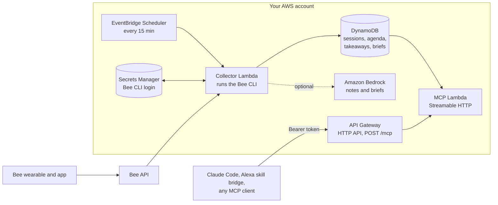

# Between Sessions

A companion for recurring 1:1 sessions (therapy, coaching, mentoring, interview loops) built on data from a [Bee](https://docs.bee.computer/docs) wearable.

Before a session it answers "what did we cover last time, what did I notice afterwards, and what do I want to bring up?" After a session it saves what Bee captured before the summaries get rewritten, and keeps the takeaways you mark.

> Status: built for the Build, Ship, Shape: Amazon Developer Hackathon (Bee track). The collector, the session store and the remote MCP server run on AWS; the Bedrock notes are built and ship switched off.

## Architecture



- **Collector Lambda** (`src/aws/collector.ts`): Node 22 on arm64. It ships the Bee CLI's Linux binary from `@beeai/cli`, restores a file-store CLI login from Secrets Manager into `/tmp`, runs `bee conversations list --json` and `bee insights list --json`, and saves the login back if the CLI refreshed its token.
- **DynamoDB** (`between-sessions`): one table, keys `PK = SERIES#<id>` and `SK = CONFIG | LATEST#SESSION | SESSION#<start>#V#<collectedAt> | AGENDA#... | TAKEAWAY#... | BRIEF#...`.
- **MCP Lambda** (`src/aws/mcp-handler.ts`): a stateless Streamable HTTP server with JSON responses. Tools answer from DynamoDB only, with no Bee or Bedrock calls on the request path.
- **Bedrock** (`src/notes/bedrock.ts`): when enabled, one Converse call per new session version writes a short session note and a prep brief.
- Everything is one CDK stack, `BetweenSessions` (`infra/stack.ts`), in `us-east-1`.

## How it uses Bee data

- **Read**: the last 21 days of conversations and insights, through the Bee CLI (`@beeai/cli`), every 15 minutes.
- **Session matching**: each *series* (for example "weekly coaching") has a schedule rule: a weekday and the local time the session usually runs. Bee can split one session into several conversations, so every conversation that overlaps that window by at least `minOverlapMinutes` becomes part of the session, as long as the parts add up to `minDurationMinutes`. Bee writes insights in nightly batches that repeat themes from earlier nights, so only the first batch after the session (within `insightWindowHours`) is attached.
- **Stored**: only matched sessions (each part's summary and short summary, times and ids) and their first insight batch, plus your own agenda items, takeaways and prep briefs. Bee rewrites summaries over time, so a new version is stored whenever the content changes, and the wording from right after the session is kept.
- **Not stored**: other conversations, raw utterances, transcripts or audio. Lambda logs hold counts, durations and ids only.
- **Tokens**: the Bee login and the MCP token live only in Secrets Manager (or a git-ignored `.env` locally).

## MCP tools

| Tool | What it does |
|---|---|
| `get_last_session {series?}` | The latest session: date, duration, parts, Bee's summary, the insights after it, version count and when it was collected |
| `list_sessions {series?, limit?}` | Recent sessions, newest first: dates, durations, part and version counts, no summaries |
| `add_agenda_item {series?, text}` | Something to bring up next time; it stays open until the next session starts |
| `list_agenda {series?}` | Open agenda items, oldest first |
| `save_takeaway {series?, text}` | Your own takeaway, filed under the latest session |
| `get_prep_brief {series?}` | The Bedrock brief if there is one, otherwise one assembled from the store: last session, short summary, insight titles, takeaways and open agenda |

Descriptions are written to be read aloud, for voice use through an Alexa skill bridge such as [alexa-skill-mcp-bridge](https://github.com/KayLerch/alexa-skill-mcp-bridge).

## Deploy to AWS

Requires Node 22.18+, Yarn via Corepack, the AWS CLI, and an AWS account bootstrapped for CDK (`corepack yarn cdk bootstrap`).

```bash
corepack yarn install

# 1. A dedicated Bee CLI login for the Lambda, stored in Secrets Manager.
#    Approve the login in the Bee app; the token is never printed.
scripts/setup-bee-secret.sh

# 2. Deploy the stack (Bedrock notes off).
corepack yarn cdk deploy BetweenSessions

# 3. Tell the collector which sessions to look for.
cp series.example.json series.local.json      # edit: your weekday, times and timezone
corepack yarn seed --store dynamo --file series.local.json

# 4. Run the collector once instead of waiting for the schedule.
aws lambda invoke --function-name between-sessions-collector out.json && cat out.json
```

The response holds counts only, for example `{"conversations":80,"insights":90,"series":1,"matched":3,"written":3,...}`.

### Connect Claude Code

The stack prints `McpUrl` and creates the bearer token as the secret `between-sessions/mcp-token`. With your own AWS credentials:

```bash
URL=$(aws cloudformation describe-stacks --stack-name BetweenSessions \
  --query "Stacks[0].Outputs[?OutputKey=='McpUrl'].OutputValue" --output text)
TOKEN=$(aws secretsmanager get-secret-value --secret-id between-sessions/mcp-token \
  --query SecretString --output text)
claude mcp add --transport http between-sessions "$URL" --header "Authorization: Bearer $TOKEN"
unset TOKEN
```

To smoke-test it without the token showing up, `corepack yarn check:remote` reads the URL from the stack and the token from `MCP_TOKEN`, and prints only shapes and counts.

### Turn on Bedrock notes

```bash
corepack yarn cdk deploy BetweenSessions -c notes=true                       # Claude Sonnet 5.5
corepack yarn cdk deploy BetweenSessions -c notes=true -c bedrockModelId=us.amazon.nova-lite-v1:0
```

Try the prompt on synthetic data first with `corepack yarn try-notes [--model <id>]`.

### Cost

For one person, a few dollars a month at most:

- Collector: about 2,900 runs a month at roughly 7 s and 1 GB each (about 20,000 GB-seconds), which fits in the Lambda free tier and costs about $0.30 a month without it.
- Secrets Manager: $0.40 a month per secret, two secrets.
- DynamoDB on demand, the HTTP API and CloudWatch Logs: cents at this volume.
- Bedrock, if enabled: one short Converse call per new session version, typically well under a few cents each.

`cdk destroy BetweenSessions` removes everything, including the table, except the Bee login secret, which `scripts/setup-bee-secret.sh` created.

### Cost guardrails (optional)

AWS has no hard spending cap, so worst-case spend is bounded in two ways. Rate limits in the stack itself: the API allows 2 requests a second (burst 5), worst case about $0.32 a day with the MCP Lambda, and the collector runs every 15 minutes, worst case about $0.38 a day. And a separate, account-wide `CostGuardrails` stack:

- `account-daily` budget ($5, gross of credits): emails at 50%, 80% and 100%; at 100% it also triggers the kill switch.
- `account-monthly` budget ($50): emails at 50% and 100% actual, and 100% forecast.
- `bedrock-daily` budget ($2): emails at 100%.
- Cost Anomaly Detection on every service: an email for each anomaly of $3 or more.
- Kill switch: a Lambda that sets every `between-sessions-*` function to 0 concurrency and emails what it did. Its IAM policy can't touch anything else.

```bash
corepack yarn cdk deploy CostGuardrails -c alertEmail=you@example.com   # confirm the SNS email
aws lambda invoke --function-name cost-guardrails-kill-switch \
  --cli-binary-format raw-in-base64-out --payload '{"dryRun":true}' out.json && cat out.json
corepack yarn guardrails:restore            # after the kill switch fired and the cause is fixed
```

Budgets update at least once a day and a daily budget compares the previous day's spend, so the kill switch fires hours after the fact. The rate limits are what bound the damage in between. Pass the same `-c alertEmail` on every deploy of this stack, or the email subscription is removed.

## Run locally

Requires the [Bee CLI](https://www.npmjs.com/package/@beeai/cli) logged in with `bee login`.

```bash
corepack yarn install
cp .env.example .env                       # set MCP_TOKEN to a long random value
cp series.example.json series.local.json   # describe your own recurring session
corepack yarn collect                      # match recent Bee data into snapshots/store.json (git-ignored, 0600)
corepack yarn mcp                          # MCP server on http://127.0.0.1:8788/mcp
corepack yarn check                        # call get_last_session; prints shape only
corepack yarn show                         # same call, full content
corepack yarn test                         # tests run on synthetic data only
```

## Privacy

This handles sensitive personal data. Everything runs in your own AWS account. Tokens live only in Secrets Manager or local environment files and are never committed. Bee exports (`bee-sync/`), local snapshots and `series.local.json` are git-ignored, and the table is deleted with the stack.

## License

[MIT](LICENSE)
