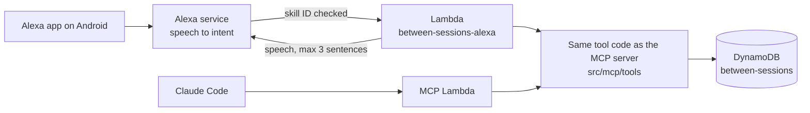

# Alexa on Android: use cases, design and plan

Status: **proposal**, Nov 2, 2026. Covers the "Voice through Alexa" item in the feature plan's [Next](FEATURE_PLAN.md#next) list. If accepted, it replaces the bridge design in [capability 5](FEATURE_PLAN.md#5-voice-through-alexa-powered-by-bedrock-asking-without-a-screen) (Oct 21).

Target: the Alexa app on an Android phone (a Pixel 6a here), signed in to the same Amazon account as the Alexa developer account.

## Summary

- **Phase 1: a classic custom skill, "Between Sessions".** It stays in the development stage, so it never needs certification and only your account can use it. A new Lambda in the `BetweenSessions` stack answers it by calling the same tool code as the MCP server, against the same DynamoDB table. It works in the Android Alexa app today, needs no Bedrock model, no OAuth server and no public endpoint, and costs cents.
- **Phase 2 (optional): an Alexa+ MCP add-on.** Alexa+ now connects to MCP servers directly ([MCP Toolkit](https://developer.amazon.com/docs/alexaplus/add-ons/mcp-toolkit-overview)), so you could ask in free-form language through our existing server. It is in Preview, needs OAuth 2.1 in front of the server and answers within 500 ms, and Amazon's docs don't yet say it works in the phone app before certification. Start it only after the gates in [Phase 2](#phase-2-alexa-mcp-add-on).
- **Drop the October bridge** (classic skill, then a third-party Lambda, then a Strands agent on Nova 2 Lite in AgentCore, then our MCP server). Alexa+ now does the agent's job natively, and phase 1 covers the rest without a model.

## Using it on the phone

**Set up once:**
1. Install the Amazon Alexa app and sign in with the Amazon account that owns the Alexa developer account.
2. Set the app's language to English (United States). The skill's locale is en-US, and they must match.
3. Enable the skill: menu, Skills & Games, Your Skills, the **Dev** tab, Between Sessions, Enable to use. With Alexa+, Amazon's docs route this through the Alexa+ Store instead ([Test and Debug Your Skill](https://developer.amazon.com/en-US/docs/alexa/test/test-your-skill-overview.html)).
4. Optional: turn on hands-free in the app. The wake word only works while the phone is unlocked and the Alexa app is on screen.
5. Optional: make Alexa the default digital assistant (Settings, Apps, Default apps, Digital assistant app), so press-and-hold opens Alexa. This adds no wake word; "Hey Google" stays Google's.
6. Check Alexa's privacy settings (see [Privacy](#privacy)).

**Talking to it:** open Alexa (the app's Alexa button, hands-free in the app, or press-and-hold), then either open the skill and talk ("Alexa, open Between Sessions") or ask in one go ("Alexa, ask Between Sessions what's happened since my last session"). Earbuds keep the answers private.

## Use cases

Each answer is three sentences or fewer, ends with one suggested next step as a question, and reads back every write. Examples use synthetic series and show the default full answers; for a series in [discreet mode](#discreet-mode), Alexa says only times and counts.

| # | Moment | You say | You hear | Tool | Phase |
|---|---|---|---|---|---|
| 1 | Any time | "Alexa, open Between Sessions" | What the Bee button filed lately ("Got it: 1 agenda item added"), when the next session is, and "You can ask for your prep brief, what's happened since last session, or add to your agenda." | receipts, `get_prep_brief` | 1 |
| 2 | Any time | "What can I ask?" / "Help" | The four-item spoken menu | `help` | 1 |
| 3 | Walking to a session | "Prep me for coaching" | "Last coaching was Tuesday: you talked about delegating. You have 2 agenda items, starting with the work trip. The full version is in Claude." | `get_prep_brief` | 1 |
| 4 | Mid-week | "What's happened since my last session?" | "It's been 5 days and 38 conversations. Sleep came up 3 times." | `get_since_last_session` | 1 |
| 5 | Planning | "When is my next session?" | "Coaching, Tuesday at 5 PM." | `get_prep_brief` | 1 |
| 6 | Before a session | "What did we cover last session?" | One-sentence paraphrase of Bee's first short summary, never the full summary | `get_last_session` | 1 |
| 7 | Mid-week | "Add the work trip to my agenda" | "Added to coaching: the work trip." | `add_agenda_item` | 1 |
| 8 | Before a session | "What's on my agenda?" | The count and up to three items, numbered | `list_agenda` | 1 |
| 9 | After the list | "Remove number two" | "Removed: the work trip." | `remove_agenda_item` | 1 |
| 10 | Right after a session | "Save a takeaway: delegate earlier" | "Saved for coaching: delegate earlier." | `save_takeaway` | 1 |
| 11 | Any time | "Which sessions need review?" | "One guess is waiting: a 52-minute conversation on Thursday, filed under coaching. It expires in 9 days." | `review_sessions` | 1 |
| 12 | After #11 | "That was an Acme interview" / "That wasn't a session" | Read-back of the move, after a yes/no confirmation | `retag_session` | 1b |
| 13 | Any time, phase 2 | Free-form ("Anything I should raise with my coach?") | Alexa+ picks the tools and phrases the answer | all tools | 2 |

**What Alexa won't do, and where it lives instead:**

| Not by Alexa | Why | Use instead |
|---|---|---|
| Start and end session markers | The Bee button marks the exact moment, hands-free, while you're wearing it | Bee button: "Marty, start session" |
| Debriefs | A debrief is a paragraph of free speech; Alexa's free-text slot is a short phrase | Bee button: "Marty, debrief: ..." |
| Reading summaries, insights or transcripts aloud | Privacy (answers are heard by anyone nearby) and length | Claude, or the review page |
| Schedule edits | Needs a form, not a sentence | `aws:review`, Schedule page |
| Anything else Bee knows | Out of scope | The boundary sentence: "I see your sessions, including any you mark with the Bee button. For anything else Bee knows, use the Bee app." |

**Where each capability is available:**

| Capability | Claude (typed) | Bee button | Alexa, phase 1 | Alexa+, phase 2 |
|---|---|---|---|---|
| Menu and help | ✅ | | ✅ | ✅ |
| Prep brief, next session | ✅ full | | ✅ short | ✅ short |
| Since last session | ✅ | | ✅ | ✅ |
| Last session | ✅ | | ✅ one sentence | ✅ |
| Agenda: add, list, remove | ✅ | add | ✅ | ✅ |
| Takeaway | ✅ | ✅ | ✅ | ✅ |
| Debrief | | ✅ | | |
| Session markers | | ✅ | | |
| Review: list | ✅ | | ✅ | ✅ |
| Review: retag, not a session | ✅ | ✅ | 1b, with confirmation | ✅ |

## Options considered

| | A. Classic custom skill (phase 1) | B. Alexa+ MCP add-on (phase 2) | C. October bridge (dropped) |
|---|---|---|---|
| How | Fixed phrases mapped to intents; our Lambda calls the tool code | Alexa+ is the MCP client of our server; free-form language | Skill, then a third-party Lambda, then a Strands agent on Nova 2 Lite in AgentCore, then our MCP server |
| Android Alexa app | Yes: dev-stage skills enable from Your Skills, Dev | Not documented: testing is the web simulator and "route your simulator session to a physical Alexa device" | Yes (as a classic skill) |
| Status | Generally available | Preview; the CLI installs from Amazon's CodeArtifact (`@alexa-ai/cli`, Node 24+) | Third-party code |
| Auth | Lambda invoke permission tied to the skill ID, plus an allowlist of your Alexa user ID; no public endpoint | OAuth 2.1 authorization code with PKCE, RFC 8414 and RFC 9728 metadata; no dynamic client registration; `client_credentials` "must not grant access to user-specific data" | Static bearer token to our MCP server |
| Model | None | Alexa+ | Nova 2 Lite on Bedrock |
| Time limit | About 8 s per response | Server round trip within 500 ms | 8 s, with the agent's model calls inside it |
| Moving parts | 1 Lambda, 1 skill package | Cognito, metadata routes, token checks, add-on package | Skill, Lambda, AgentCore runtime, model, our server |
| Cost | Cents | Cents, plus about $2 to $4 a month if the MCP Lambda needs provisioned concurrency for 500 ms | Model calls and AgentCore |

## Phase 1 design: classic custom skill

**Skill package**, committed in `alexa/skill-package/`:
- `skill.json`: name "Between Sessions", invocation name "between sessions", locale en-US, endpoint the Alexa Lambda's ARN, no account linking, never submitted for certification.
- `interactionModels/custom/en-US.json`: the intents below. The `SERIES` slot type holds only generic values (therapy, coaching, interview, other). Your real series names and spoken names are loaded per session with dynamic entities (`Dialog.UpdateDynamicEntities` on launch, from `store.listSeries()`), so they never enter the public repo.

| Intent | Sample phrases | Slots | Calls |
|---|---|---|---|
| LaunchRequest | "open Between Sessions" | | receipts line, next session, menu |
| `AMAZON.HelpIntent` | "help", "what can I ask" | | `help` |
| `PrepBriefIntent` | "prep me", "give me my prep brief", "prep me for {series}" | `series` | `get_prep_brief` |
| `SinceLastSessionIntent` | "what's happened since my last session", "since my last {series} session" | `series` | `get_since_last_session` |
| `NextSessionIntent` | "when is my next session", "when's my next {series} session" | `series` | `get_prep_brief` (next session only) |
| `LastSessionIntent` | "what did we cover last session" | `series` | `get_last_session` |
| `AddAgendaItemIntent` | "add {item} to my agenda", "put {item} on my agenda" | `item` (`AMAZON.SearchQuery`) | `add_agenda_item` |
| `ListAgendaIntent` | "what's on my agenda" | `series` | `list_agenda` |
| `RemoveAgendaItemIntent` | "remove number {n}", "remove {item} from my agenda" | `n` (`AMAZON.NUMBER`), `item` | `remove_agenda_item` |
| `SaveTakeawayIntent` | "save a takeaway {takeaway}", "my takeaway is {takeaway}" (not the bare "takeaway {takeaway}": spike 2) | `takeaway` (`AMAZON.SearchQuery`) | `save_takeaway` |
| `ReviewIntent` | "which sessions need review" | | `review_sessions` |
| `RetagIntent` (1b) | "that was {series}", "that wasn't a session" | `series` | `retag_session`, after `AMAZON.YesIntent` |
| `AMAZON.FallbackIntent` | anything else | | the boundary sentence |
| Stop, Cancel, `AMAZON.NavigateHomeIntent` | | | ends the session |

When no series is named, the existing `chooseSeries` rules pick one, and the read-back always names it ("Added to coaching: ..."), so a wrong pick is heard and can be fixed. A free-text slot can't share a phrase with a series slot (spike 2, Nov 2: the model build rejects it), so the agenda and takeaway intents take no `{series}`. To aim at a series, name it first in a separate phrase ("what's on my coaching agenda" or "prep me for coaching"), which sets it for the rest of the session; otherwise `chooseSeries` picks and the read-back says which.

**Code:**
- `src/alexa/handler.ts`: routes each request to a tool through `ToolDef.call(args, { store })`, the same path the review page uses. Checks that `session.application.applicationId` is our skill ID and that `context.System.user.userId` is on the allowlist; anything else gets a polite refusal and is not logged. Keeps the last list read in session attributes, so "remove number two" refers to what you heard.
- `src/alexa/speech.ts`: one renderer per tool view, from the JSON the tools already return. At most three sentences; numbers and dates spoken naturally; Bee text only as a one-line paraphrase of the short summary; writes read back; the tool's `next` hint becomes the reprompt, which keeps the session open for one more ask. SSML-escaped.
- `src/aws/alexa-handler.ts`: the Lambda entry point with `dynamoStore()`, like `mcp-handler.ts` without the token.
- No cards. Cards persist in the Alexa app's activity, so the skill sends speech only.
- Logs hold the intent name, the outcome and the duration, never slot values or speech.

**Infrastructure**, in `infra/stack.ts`:
- `fn("Alexa", "src/aws/alexa-handler.ts", ...)`: Node 22 on arm64, 256 MB, a 7 s timeout. Its name, `between-sessions-alexa`, is already covered by the kill switch's prefix.
- `table.grantReadWriteData(alexa)`, the same as the MCP Lambda.
- `alexa.addPermission(...)` for the principal `alexa-appkit.amazon.com` with `eventSourceToken` set to the skill ID, so only this skill can invoke it.
- The skill ID and allowed user IDs come from CDK context (`-c alexaSkillId=... -c alexaUserIds=...`) and are never committed. A stack output, `AlexaFunctionArn`, goes into `skill.json`'s endpoint.

**Commands**, following the `aws:`/`local:`/`demo:` naming:
- `demo:alexa`: runs a scripted conversation (every intent) through the handler on the synthetic demo store and prints what Alexa would say, with sentence counts. No Alexa or AWS needed.
- `aws:alexa-deploy`: deploys the skill package with the ASK CLI (`ask deploy --target skill-metadata`).
- `aws:alexa-dialog`: `ask dialog` against the development skill, to test real speech understanding by typing.

**Time and cost:** a warm DynamoDB-backed answer takes a few hundred milliseconds, and a cold start a second or two, well inside about 8 s. No model and no provisioned concurrency, so the cost is a few Lambda requests a day.

### Discreet mode

Alexa+ keeps a text transcript of every exchange until the chat has been inactive for 30 days, and that can't be turned off (spike 3). Discreet mode limits what lands there: Alexa speaks only times and counts, never the series name, item text, topics or summaries, and points to Claude for the rest. It changes only what Alexa says; Claude and the MCP tools are unchanged.

- **Off by default.** The default is a constant in the source, `DISCREET_BY_DEFAULT = false` in `src/alexa/speech.ts`, so you hear full answers while building and testing.
- **Per series.** A series can override the default with an optional `discreet: true` in its config (`series.local.json`, written with `aws:seed`). The field is added to the series schema in `src/series.ts` as optional, so existing series need no change. There is no switch in the review page or Schedule page.
- **Documented.** The README's Alexa section says that discreet mode exists, that it is off by default, and how to turn it on for a series.
- **Turn it on for therapy before real use**, then check one exchange in the Alexa app's chat history.

| | Full (default) | Discreet |
|---|---|---|
| The series | "your coaching session" | "your Tuesday session" (weekday and time, never the name) |
| Prep brief | When the last session was, a one-line paraphrase, the agenda count and first item | "Your Tuesday session is at 5. You have 2 agenda items. The details are in Claude." |
| Since last session | Days, conversations, topics that came back | Days and conversations only |
| Last session | A one-sentence paraphrase | "It was on Tuesday. The summary is in Claude." |
| Agenda list | The count and up to three items | The count only |
| Writes (agenda, takeaway) | "Added to coaching: the work trip." | "Added to your agenda." |
| Review queue | Time, length and guessed series | The count only |
| Launch receipts | Counts and times | The same (already counts and times only) |

## Privacy

- **Heard aloud.** Answers come out of the phone's speaker unless you wear earbuds. That's why answers stay short and never read summaries, insights or transcripts.
- **Content leaves your AWS account.** What you say and what the skill answers pass through Amazon's Alexa service. With "Don't save", recordings are deleted, but chat transcripts stay until the chat has been inactive for 30 days, readable in the Alexa app; you can only delete them by hand (spike 3). This is the same kind of decision as push delivery in the feature plan. [Discreet mode](#discreet-mode) keeps therapy answers to times and counts; anything you say yourself, such as an agenda item, is in the transcript either way, so sensitive items are better captured with the Bee button or in Claude.
- **Three places, three sets of rules.** Bee keeps transcripts encrypted with keys only your device holds, with 14 days of memory on the free tier (Amazon's own claims). The collector copies summaries and insights into your AWS account, where they are kept indefinitely under your IAM controls; that is the point of the product, and outside Bee's encryption. Alexa then holds whatever it heard or said as text that Amazon can read, for 30 days after a chat goes quiet. Discreet mode limits that last step.
- **Bee hears Alexa.** If you're wearing the Bee, it records the spoken answers as a conversation. That adds to "conversations since" and can bump topic counts in the digest. Earbuds avoid it; a later fix could ignore very short conversations in topic counts.
- **Only you.** A development-stage skill is available only to the developer's own Amazon account, and the Lambda also checks your Alexa user ID. On a shared Echo, a voice profile check (`person.personId`) would be needed too; phase 1 targets the phone only.

## Phase 2: Alexa+ MCP add-on

**Start only when all three gates pass** (about 1 hour):
1. Preview access: the Alexa AI CLI installs (`npm install -g @alexa-ai/cli` after the CodeArtifact login, on Node 24) and `alexa-ai configure` succeeds.
2. Your Amazon account has Alexa+ in the Android app.
3. A development-stage add-on is reachable from the phone, not only the web simulator. Test with a throwaway add-on on a public, no-data MCP server.

**Changes it needs:**
1. **OAuth 2.1 for the MCP server.** A Cognito user pool (sign-up off, one user) with an app client for Alexa (authorization code with PKCE S256) and scopes `mcp:tools` and `mcp:resources`. The API serves `/.well-known/oauth-protected-resource` (RFC 9728) and `/.well-known/oauth-authorization-server` (RFC 8414). The MCP Lambda accepts either the static bearer token (Claude Code, as today) or a Cognito access token with the right scope and audience.
2. **500 ms round trip.** Measure p95 through API Gateway; if cold starts miss it, add provisioned concurrency of 1 to the MCP Lambda.
3. **Tool results** add `structuredContent` next to the text, and tool descriptions get a pass against Amazon's [MCP design guide](https://developer.amazon.com/docs/alexaplus/add-ons/mcp-addon-design-guide).
4. **The add-on package** (`alexa-ai new mcp`, `addon.json`): name, descriptions, 3 or 4 example phrases, icons, a carousel image, and privacy policy and terms URLs (simple pages in this repo).
5. **No certification** while it's for your own use, if gate 3 shows the development stage is enough.

**Side benefit:** the same Cognito OAuth unblocks the claude.ai and Claude mobile connector, another item on the Next list.

## Implementation plan

### Step 1: fail fast (about 2 hours, no product code)

Test the assumptions that could kill the plan first, with throwaway parts and synthetic phrases only. Run the spikes in order and stop at the first failure. Record the results in [Spike results](#spike-results).

| # | Riskiest assumption | Cheapest test | Time | If it fails |
|---|---|---|---|---|
| 1 | A development-stage classic skill opens in the Alexa app on the phone, even on an account with Alexa+ | The spike skill below, enabled from Your Skills, Dev. Try "Alexa, open hello spike" and the one-shot "Alexa, ask hello spike to say hi" | 30 min | Phase 1 is dead. Only the Alexa+ add-on is left, so spike 4 decides |
| 2 | Alexa hears free text well enough for agenda items and takeaways | Say the 10 phrases below to the spike skill, which repeats what it heard. (Nov 2: free text plus a series in one phrase doesn't build; see the results) | 30 min | 7 or fewer of 10 right: drop voice writes. Alexa becomes read-only (brief, digest, next session) and the Bee button keeps capture. Smaller, still worth building |
| 3 | The privacy trade-off is acceptable for therapy content | After spikes 1 and 2, open Alexa Privacy, review voice history: are your words kept, Alexa's answers, or both? Does "don't save recordings" stop it? | 15 min | Your call: limit Alexa to non-sensitive answers (next session, counts), or stop |
| 4 | Phase 2 is reachable | Ask for Alexa+ for Builders Preview access. Nov 2: `@alexa-ai/cli` is not on the public npm registry (404), so the CLI comes through Amazon's CodeArtifact after access is granted; it also needs Node 24 | 15 min, then waiting | Park phase 2. It doesn't block phase 1 |

Later, because they only change details: hands-free on this phone, whether Bee records Alexa's answers, and whether Cognito accepts the `resource` parameter (only once phase 2 is unblocked).

**The spike skill** ([alexa/spike/](../alexa/spike/)): it echoes what it heard, stores nothing, logs nothing and sends no cards.
1. In the [Alexa developer console](https://developer.amazon.com/alexa/console/ask), create a skill: name "Hello Spike", locale English (US), a custom model, the **Alexa-hosted (Node.js)** backend, and the "Start from scratch" template. No AWS stack or CLI is needed.
2. Build tab, Interaction Model, JSON Editor: paste [interaction-model.json](../alexa/spike/interaction-model.json), Save, Build. (An earlier version had an `AgendaSeriesIntent`; the build rejected it, see the results.)
3. Code tab: replace `lambda/index.js` with [index.js](../alexa/spike/index.js), Save, Deploy.
4. Test tab: set testing to Development and type "open hello spike" to check it.
5. On the phone: Alexa app, Skills & Games, Your Skills, Dev, Hello Spike, enable. Then talk to it.
6. When done, delete the skill in the console.

**Phrases for spike 2** (synthetic). Count a phrase right when the words that would be stored are right, ignoring punctuation:

1. "Add the work trip to my agenda"
2. "Add sleep to my agenda"
3. "Put asking for a raise on my agenda"
4. "Add my sister's visit to my agenda"
5. "Add feeling stuck at work to my agenda"
6. "Add the Acme offer deadline to my agenda"
7. "Save a takeaway: delegate earlier"
8. "Takeaway: say no to the extra project"
9. "Save a takeaway: walk after lunch"
10. "Add what to do about the holidays to my agenda"

#### Spike results

| # | Date | Result | Notes |
|---|---|---|---|
| 1 | Nov 2 | **Pass** (simulator and phone) | The account is on Alexa+. "open hello spike" hands off to the development-stage skill: Alexa+ says "Here's Hello Spike. Say 'Alexa exit' to get back to Alexa plus.", then the skill's own code answers. You stay in the skill until "Alexa exit". On the phone (Alexa+ app), "open hello spike" worked the same way, with no need to enable the skill from the Dev tab. The one-shot "Alexa, ask hello spike to say hi" also worked |
| 2 | Nov 2 | **Pass**, 8 of 10 | By voice on the phone: #8 ("Takeaway: say no to the extra project") failed every time, about a dozen tries; the bare "takeaway ..." phrasing is unreliable, while "save a takeaway ..." (#7, #9) worked. Build: the model rejected "add {item} to my {series} agenda": "cannot include both a phrase slot and another intent slot". So a free-text item can't name its series in the same phrase. Voice accuracy still to test |
| 3 | Nov 2 | **Text is kept**: your call | Alexa Privacy, Manage Your Alexa Data, "Voice Recordings and Transcripts" offers Don't retain, 3 months, 18 months or until deleted; set to Don't retain. Even so, the Alexa+ app's chat history kept a text transcript of later exchanges (including Alexa's answers), and of the 6:05 PM spike conversation, across a phone restart. Voice History listed only the "open hello spike" request (text and audio), not the turns inside the skill, which did show in the app's chat. Amazon's help page confirms it: with "Don't save", "chat transcripts and typed requests are kept until they've been inactive for 30 days", then deleted ([Delete Alexa Voice Recordings and Transcripts Automatically](https://www.amazon.com/gp/help/customer/display.html?nodeId=G68KUKTXN92WY3C3)). There is no setting to stop that; chats can be deleted by hand under Alexa Privacy, Review Voice History, and voice deletion ("delete what I just said") doesn't work with Alexa+ ([Ask Alexa to Delete Your Voice History](https://www.amazon.com/gp/help/customer/display.html?nodeId=GYRPHMGANH7M2BNH)) |
| 4 | Nov 2 | Not yet | `@alexa-ai/cli` is not on public npm; Preview access needed |

### Step 2: phase 1, starting with one intent end to end

If spikes 1 and 2 pass, build one read-only intent through the real path before any breadth: the phone, the development skill, `between-sessions-alexa` with the skill ID permission and user check, DynamoDB, and one spoken sentence back. That proves the last unknowns (the Lambda permission, cold start on the phone, your real series names through dynamic entities) in about half a day. Install the ASK CLI first (`npm install -g ask-cli`, `ask configure`; `ask smapi list-skills-for-vendor` works).

**Phase 1** (about 1.5 to 2 days, after step 1 passes). If spike 2 failed, leave out the writes (use cases 7, 9, 10 and 12).

| # | Step | Files | Done when |
|---|---|---|---|
| 1 | One intent end to end: launch, help and `NextSessionIntent` only | `src/alexa/handler.ts`, `src/alexa/speech.ts`, `src/aws/alexa-handler.ts`, `infra/stack.ts`, `alexa/skill-package/` | On the phone, "Alexa, ask Between Sessions when my next session is" answers in one sentence; a request with another skill ID or user ID is refused; `aws:deploy -c alexaSkillId=... -c alexaUserIds=...` deploys and only the skill can invoke the function |
| 2 | Speech renderers for every tool, full and [discreet](#discreet-mode), with tests on synthetic data; the optional `discreet` series field | `src/alexa/speech.ts` (with `DISCREET_BY_DEFAULT = false`), `src/series.ts`, `test/alexa-speech.test.ts` | Every tool view renders in at most 3 sentences; writes read back; no Bee text beyond one paraphrased sentence; discreet output never contains the series name, item text, topics or summary text; existing series load unchanged |
| 3 | Handler for every intent: routing, session attributes, dynamic entities | `src/alexa/handler.ts`, `test/alexa-handler.test.ts`, `test/fixtures/alexa/*.json` (synthetic requests) | Every intent answers; Fallback gives the boundary sentence |
| 4 | The full interaction model | `alexa/skill-package/` | `ask deploy --target skill-metadata` builds the model without errors |
| 5 | Dialog test | `aws:alexa-deploy`, `aws:alexa-dialog` | Use cases 1 to 11 pass in `ask dialog` |
| 6 | On the phone | | Use cases 1 to 11 pass by voice; note misheard phrases and add samples |
| 7 | `demo:alexa` scripted conversation | `scripts/alexa-demo.ts`, `package.json` | Prints a full conversation on the demo store |
| 8 | Docs | README (an "Alexa" section and the Who runs what table), `docs/TESTING.md`, feature plan capability 5 and Next | A new reader can set it up from the README; the README notes that discreet mode exists, is off by default, and how to turn it on for a series |
| 9 | Phase 1b: retag by voice, with confirmation | handler, model, tests | Use case 12 passes, and "no" changes nothing |

**Before real use:** turn on discreet mode for therapy (`discreet: true` in `series.local.json`, then `aws:seed`), and check one exchange in the Alexa app's chat history.

**Works when:** on the phone, with the Bee button and Claude unchanged, "Alexa, ask Between Sessions to prep me" answers in under about 3 seconds with at most three sentences, and "add the work trip to my agenda" shows up in Claude's `list_agenda` straight away.

### Step 3: phase 2, only after its gates

About 2 to 3 days, once spike 4 and the gates in [Phase 2](#phase-2-alexa-mcp-add-on) pass: Cognito and metadata routes, token checks in the MCP Lambda, latency measurement, the add-on package, simulator tests, phone tests.

## Open questions

| # | Question | How it gets answered |
|---|---|---|
| 1 | Does a development-stage classic skill still open on an account with Alexa+? | Spike 1 |
| 2 | ~~Can an agenda phrase carry both a free-text item and a series name?~~ | **No** (spike 2 build, Nov 2): a phrase slot can't share an utterance with another slot. Name the series in an earlier phrase instead |
| 3 | What does Alexa's activity history keep of the skill's answers, and can it be turned off? | Spike 3 |
| 4 | Can a development-stage Alexa+ add-on be used from the phone without certification? | Spike 4, then phase 2 gate 3 |
| 5 | Does Cognito accept the `resource` parameter (RFC 8707) that MCP clients send, and can the metadata live on our API's domain? | A spike against a test user pool before phase 2 step 1 |
| 6 | Does the MCP Lambda stay within 500 ms including cold starts? | p95 measurement in phase 2 |
| 7 | Does hands-free in the Alexa app work on this phone with the current app version? | Any time; it only changes how you open Alexa |

## Sources

- [Alexa+ MCP Toolkit overview](https://developer.amazon.com/docs/alexaplus/add-ons/mcp-toolkit-overview) and [quickstart](https://developer.amazon.com/docs/alexaplus/add-ons/mcp-toolkit-quickstart): Streamable HTTP, MCP 2025-11-25, 500 ms, OAuth requirements.
- [Alexa+ MCP authentication](https://developer.amazon.com/docs/alexaplus/add-ons/mcp-toolkit-authentication): the two auth tiers, scopes, what's not supported.
- [Test your MCP add-ons](https://developer.amazon.com/docs/alexaplus/add-ons/mcp-toolkit-test-add-ons) and [client lifecycle](https://developer.amazon.com/docs/alexaplus/add-ons/mcp-toolkit-client-lifecycle.html).
- [Set up your development environment](https://developer.amazon.com/docs/alexaplus/add-ons/set-up-your-development-environment): Node 24+, `@alexa-ai/cli`.
- [Alexa+ launches new ways to build experiences](https://developer.amazon.com/alexaplus/blogs/2026/07/alexa-plus-new-ways-to-build-experiences) (July 2026): "currently available in Preview".
- [Test and Debug Your Skill](https://developer.amazon.com/en-US/docs/alexa/test/test-your-skill-overview.html): enabling a development skill in the Alexa app.
- Hands-free in the Alexa app on Android: [Android Central](https://androidcentral.com/you-can-now-use-amazon-alexa-hands-free-android-phones), [TechCrunch](https://techcrunch.com/2020/07/07/amazon-adds-hands-free-alexa-to-its-alexa-mobile-app/); default assistant: [How-To Geek](https://www.howtogeek.com/351554/how-to-set-alexa-as-your-default-digital-assistant-on-android/). These are older articles; check them on the phone during the spikes.
