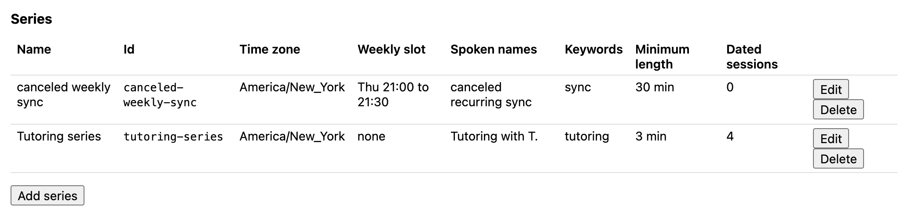
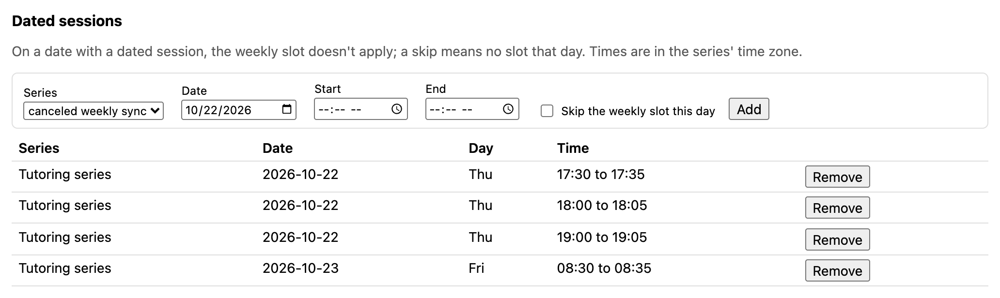
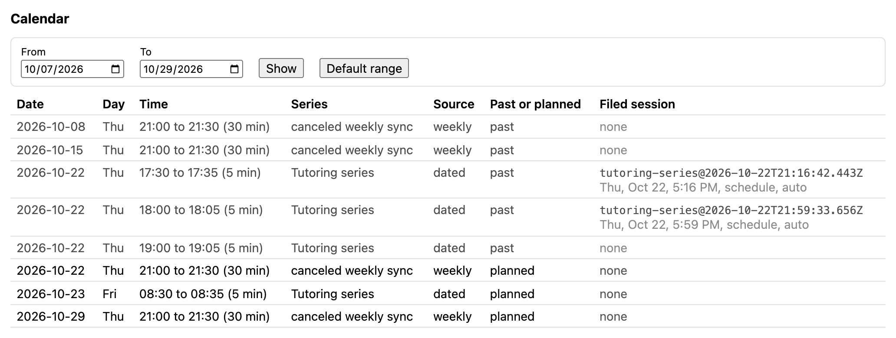
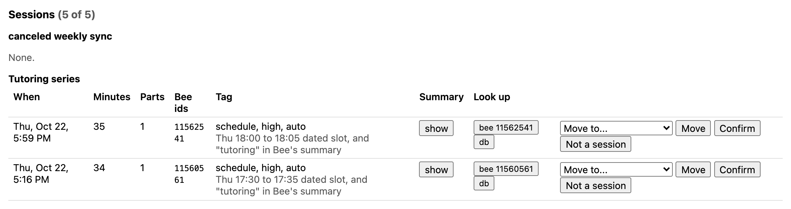
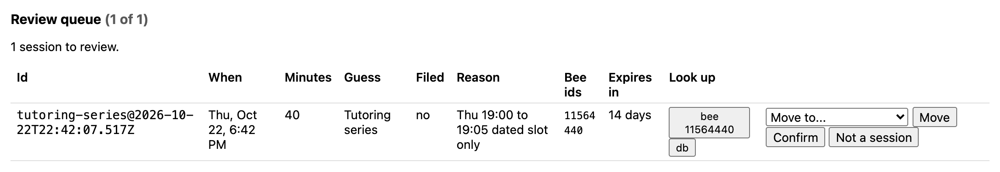
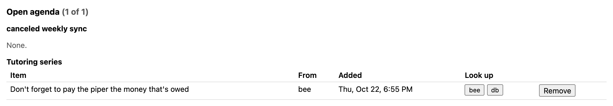
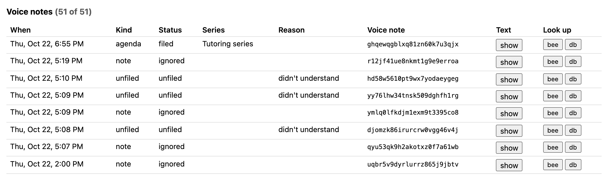

# Demo fallback: one evening on a real Bee (Thu Oct 22, 2026)

If the video doesn't play, this page shows the same thing with screenshots: Between Sessions filing real Bee conversations into recurring sessions from the schedule alone, with no button presses, plus one voice command filed through the Bee button.

**About the screenshots.** They come from the two local pages (`corepack yarn review-ui`, and its Schedule page) running against the deployed DynamoDB table, filled from a real Bee device by the collector Lambda.
- Summaries stay hidden, as the pages do by default.
- One real personal series is removed from the images, and a person's name is shortened to "T.". The section counts ("5 of 5") still include the removed series.
- The test sessions were role-played scripts, not real meetings.
- State as of 19:40 ET.

## The setup: three 5-minute slots tonight

A series can have a weekly slot, dated slots, or both. For the test, "Tutoring series" got three dated 5-minute slots tonight and one tomorrow morning:
- A minimum length of 3 minutes means a slot needs 3 of its 5 minutes inside a Bee conversation.
- The keyword `tutoring` must appear in Bee's own summary for a session to file without review.

"canceled weekly sync" is a weekly slot (Thu 21:00 to 21:30) where nothing is meant to happen: the empty-slot test.





## The results

Nobody touched the Bee button to start or end anything. The collector runs every 15 minutes on AWS, reads Bee's conversations through the Bee CLI, and places them by slot.

| Slot | What happened | Bee conversation | Result |
|------|---------------|------------------|--------|
| Thu 17:30 to 17:35 | A tutoring script | 11560561, 17:16 to 17:50 | **Filed, auto**: "Thu 17:30 to 17:35 dated slot, and "tutoring" in Bee's summary" |
| Thu 18:00 to 18:05 | A follow-up tutoring script | 11562541, 17:59 to 18:34 | **Filed, auto**: "Thu 18:00 to 18:05 dated slot, and "tutoring" in Bee's summary" |
| Thu 19:00 to 19:05 | Deliberately off-topic (planning a hike; "tutoring" never said) | 11564440, 18:42 to 19:22 | **Waiting for review**: "Thu 19:00 to 19:05 dated slot only". A slot with no keyword isn't filed by itself |
| Thu 21:00 to 21:30 | Nothing planned | | Still to come |
| Fri 08:30 to 08:35 | A tutoring script, starting 2 minutes late | | Still to come |

The calendar ties each slot to the session filed in it:



The two filed sessions, with the evidence in each tag. Every row has the full Bee ids and copyable lookups: `bee conversations get <id> --json`, and the DynamoDB item behind the row.



The off-topic conversation in the 19:00 slot waits for a person, with Confirm, Move and "Not a session" on the row:



## A voice command through the Bee button

Between sessions, one hold-and-speak voice note: "Marty, agenda for tutoring. Don't forget to pay the piper the money that's owed."
- The watcher (`corepack yarn watch --collect`) follows `bee stream`, shows the verdict within seconds, then runs the collector Lambda.
- The agenda item was filed on the Tutoring series, marked as from Bee.

```
17:59:34 new-conversation 11562541 CAPTURING
18:34:48 update-conversation 11562541 PROCESSING
18:35:07 update-conversation 11562541 COMPLETED
18:42:07 new-conversation 11564440 CAPTURING
18:55:28 journal-text …3qjx 14 words: "Marty, agenda for tutoring. Don't forget to pay the piper the money that's owed."
18:55:32 journal-updated …3qjx READY heard "Marty, agenda for tutoring. …" -> AGENDA (series tutoring, existing series)
18:55:32 running the collector...
18:55:35 collector: 135 conversations, 129 insights, 3 series, 5 matched, 0 replaced, 0 written (0 sessions), 0 briefs, 0 briefs failed, config refreshed no, 2.3s
19:22:10 update-conversation 11564440 PROCESSING
19:22:29 update-conversation 11564440 COMPLETED
```



Every voice note is listed with what it did:
- **"filed":** the agenda item above.
- **"ignored":** a plain note with no "Marty", so it isn't a command.
- **"unfiled, didn't understand":** a note addressed to Marty that couldn't be read. It's reported in the next brief, never dropped silently.

Note text stays hidden behind "show".



## What this shows

- **Real Bee data, Bee CLI in code:** the collector Lambda ships the Bee CLI's Linux binary and runs `bee conversations list`, `bee insights list`, `bee journals list` and `bee todos list`. The local watcher follows `bee stream`.
- **Schedule-only capture works for short slots:** only the minutes inside the slot count. So Bee's long conversations (34 to 40 minutes here, around 5-minute slots) still file into the right slot.
- **Unsure guesses wait for a person:** a slot with no keyword in Bee's summary goes to review instead of being filed.
- **AWS backend:** Lambda, EventBridge Scheduler, DynamoDB and Secrets Manager. See the [README](../README.md#architecture).

## What we learned (also in the friction log)

- **Bee closes conversations late.** Each conversation stayed open 13 to 27 minutes after the talk ended, and Bee merged talk separated by short gaps. The 19:00 conversation began at 18:42.
- **An open conversation can't be filed.** It has no end time yet, so the 19:00 result only appeared after Bee closed the conversation at 19:22. Opening the Bee app helps it upload.
- **Natural phrasing isn't always understood.** "Marty, add to next <series> session an agenda item for …" isn't understood; "Marty, agenda for <series>: …" is. It was reported as not understood rather than dropped.

## Reproduce

```bash
corepack yarn review-ui
```
```bash
AWS_PROFILE=bee-agent AWS_REGION=us-east-1 corepack yarn watch --collect
```
```bash
AWS_PROFILE=bee-agent aws lambda invoke --function-name between-sessions-collector --region us-east-1 /tmp/collect-out.json
```
