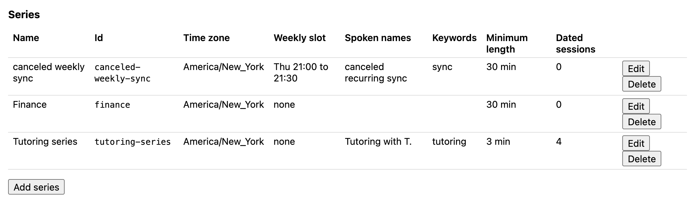
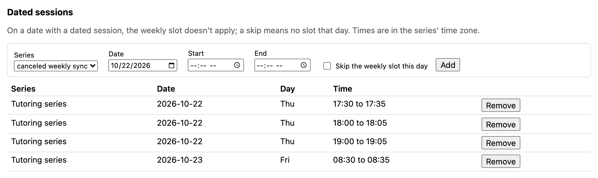
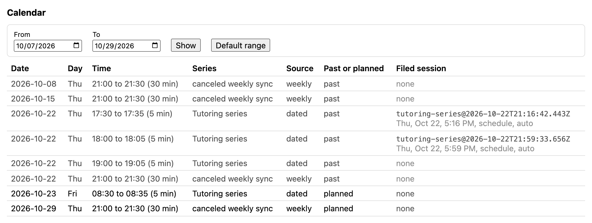
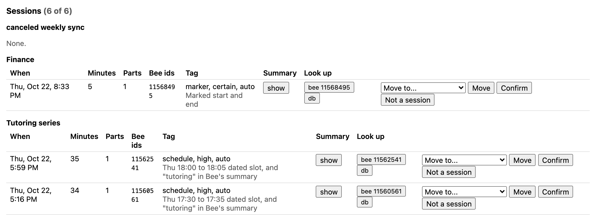
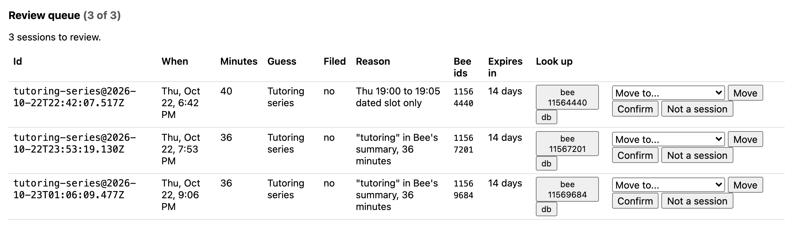
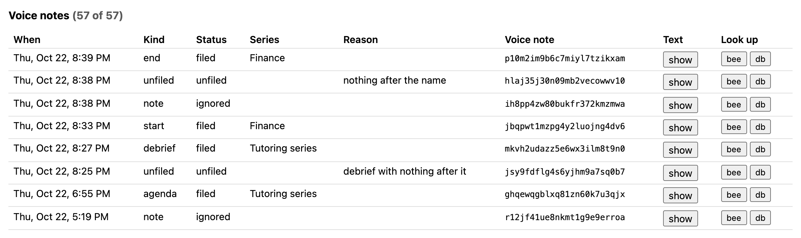
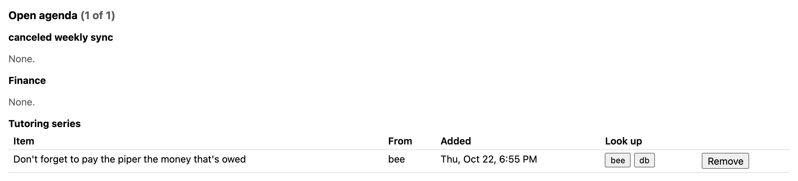

# Demo fallback, second take: the same evening at 22:35 (Thu Oct 22, 2026)

The [first take](DEMO_FALLBACK.md) was recorded at 19:40. This one adds what happened after:
- the empty-slot test at 21:00;
- an unscheduled Finance session started and ended with the Bee button;
- a debrief by voice;
- two more guesses in the review queue.

**About the screenshots.** They come from the two local pages (`corepack yarn review-ui`, and its Schedule page) running against the deployed DynamoDB table, filled from a real Bee device by the collector Lambda.
- Summaries stay hidden, as the pages do by default.
- One real personal series is removed from the images, and a person's name is shortened to "T.". The section counts ("6 of 6") still include the removed series.
- The test sessions were role-played scripts, not real meetings.
- State as of 22:35 ET.

## The setup

Unchanged from the first take:
- **"Tutoring series"** has three dated 5-minute slots tonight and one tomorrow morning, a minimum length of 3 minutes, and the keyword `tutoring`.
- **"canceled weekly sync"** has a weekly slot, Thu 21:00 to 21:30, with a minimum length of 30 minutes and the keyword `sync`. Nothing is meant to happen in it.





## The results

| Slot or event | What happened | Bee conversation | Result |
|------|---------------|------------------|--------|
| Thu 17:30 to 17:35 | A tutoring script | 11560561, 17:16 to 17:50 | **Filed, auto**: "Thu 17:30 to 17:35 dated slot, and "tutoring" in Bee's summary" |
| Thu 18:00 to 18:05 | A follow-up tutoring script | 11562541, 17:59 to 18:34 | **Filed, auto**: "Thu 18:00 to 18:05 dated slot, and "tutoring" in Bee's summary" |
| Thu 19:00 to 19:05 | Deliberately off-topic (planning a hike; "tutoring" never said) | 11564440, 18:42 to 19:22 | **Waiting for review**: "Thu 19:00 to 19:05 dated slot only" |
| No slot | Talk before the Finance session, closed with a double-press | 11567201, 19:53 to 20:29 | **Waiting for review**: "tutoring" in Bee's summary, 36 minutes |
| Bee button, 20:33 to 20:39 | "Hey Marty, start finance session" … "Hey Marty, end finance session" | 11568495 | **Filed, certain**: a new Finance series and a 5-minute session, "Marked start and end" |
| Thu 21:00 to 21:30 | Nothing planned | 11569684, 21:06 to 21:41 | **Empty, as intended.** The conversation overlapped the slot by 24 minutes, under the 30-minute minimum. It went to review as a keyword guess instead |
| Fri 08:30 to 08:35 | A tutoring script, starting 2 minutes late | | Still to come |

The calendar shows the 21:00 slot as past, with no filed session:



Filed sessions: the two tutoring slots and the Finance session from the Bee button.



Three guesses wait for a person, each with Confirm, Move and "Not a session":



## The Bee button: an unscheduled session

The Finance meeting wasn't on any schedule. The steps:
1. Double-press the Bee button, which closes the open conversation.
2. Hold the button: "Hey Marty, start finance session." The Finance series didn't exist, so the start note created it.
3. About five minutes of meeting.
4. Hold the button: "Hey Marty, end finance session."

The session was saved at once, with no conversation in it yet. It filled in at the first collector run after Bee closed the conversation.

```
20:29:45 update-conversation 11567201 COMPLETED
20:33:48 journal-updated …4dv6 READY heard "Hey Marty, start finance session." -> START, series finance (new series)
20:38:39 journal-updated …zmwa READY heard "Hey." -> plain note
20:38:49 journal-updated …wv10 READY heard "Hey Marty!" -> can't file: nothing after the name
20:39:08 journal-updated …kxam READY heard "Hey Marty, end finance session." -> END, series finance (existing series)
20:39:10 collector: 138 conversations, 129 insights, 4 series, 6 matched, 0 replaced, 1 written (1 sessions), 0 briefs, 0 briefs failed, config refreshed no, 2.7s
```

Both false starts were recorded:
- "Hey." was kept as a plain note.
- "Hey Marty!" was recorded as "unfiled, nothing after the name". It will be reported in the next brief.



The agenda item from the first take is still open on the Tutoring series:



## What this adds

- **The empty slot stayed empty.** A conversation that starts inside a slot but covers less than the series' minimum isn't filed into it.
- **Markers make a session out of nothing.** A start note can create a new series, and an unscheduled session needs no setup.
- **A double-press before and after a marked session keeps it clean.** Marked sessions take whole Bee conversations, which can't be split.
- **Keyword guesses go to review, not into a session.** Long conversations whose Bee summary mentions "tutoring" are offered as guesses.

## Reproduce

```bash
corepack yarn review-ui
```
```bash
AWS_PROFILE=bee-agent AWS_REGION=us-east-1 corepack yarn watch --collect
```
```bash
AWS_PROFILE=bee-agent aws lambda invoke --function-name between-sessions-collector --region us-east-1 /tmp/collect-out.json
```
